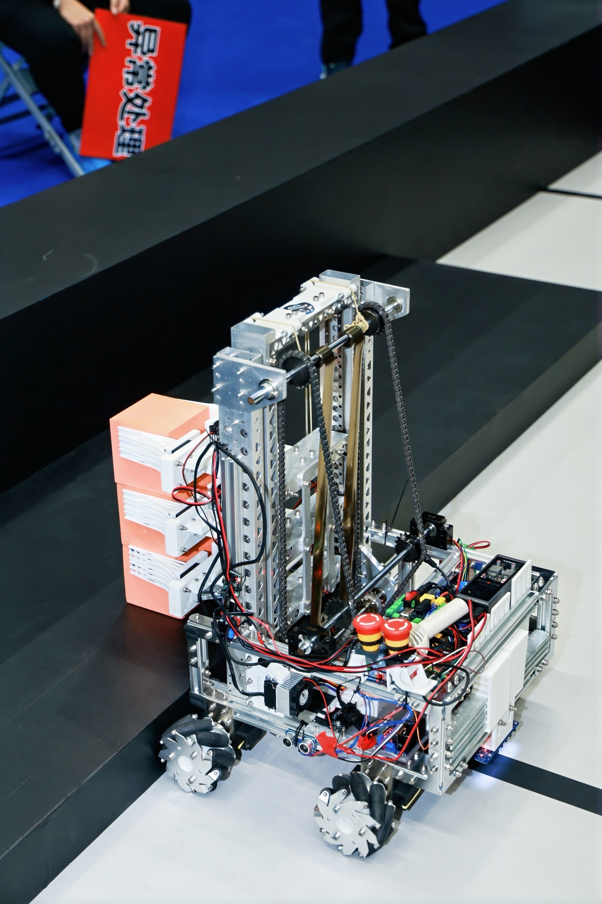
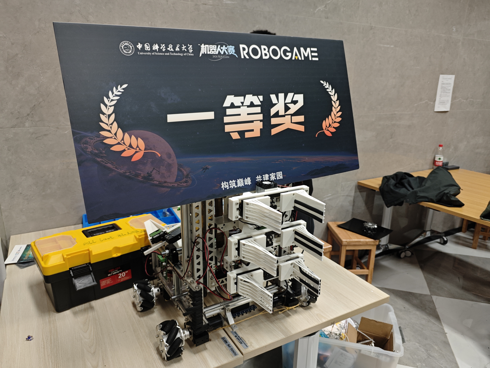
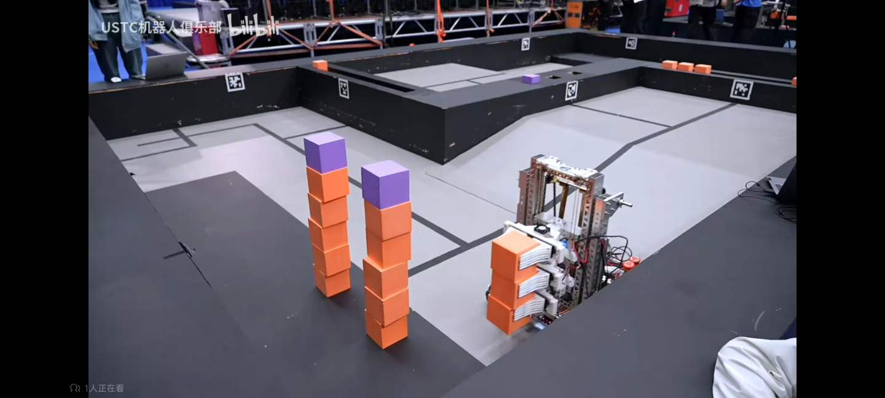
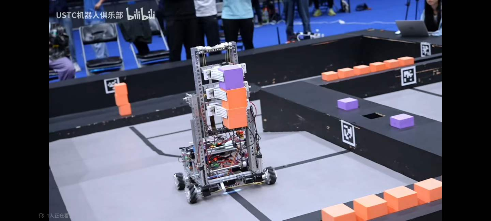
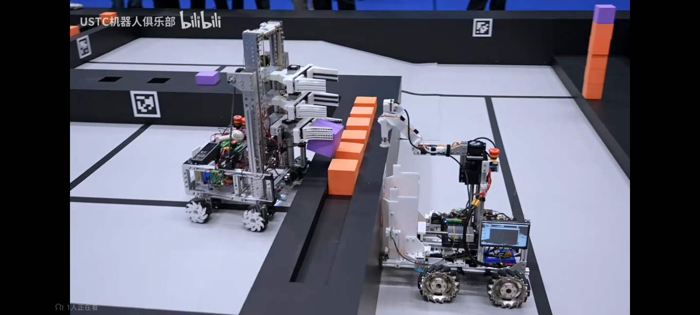
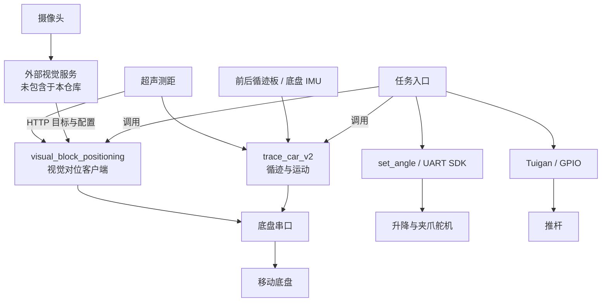
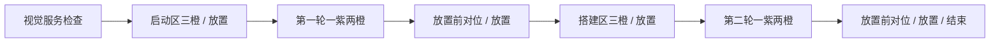

# RoboGame 2026 Robot

A Raspberry Pi based mobile manipulation robot developed for RoboGame 2026, focusing on vision-based alignment, line following, servo manipulation and real-world robot system integration.

RoboGame 2026 移动操作机器人项目，展示机器人视觉定位、循迹控制、机械执行和软硬件系统联调实践。

## Overview

这是本科阶段的团队机器人系统工程项目。机器人按场地路线到达取料区，通过颜色目标对位和测距接近，再编排升降、夹爪与推杆完成计划取放流程。项目的价值在于跨模块集成与真机调试经历。

本仓库保存历史比赛工程快照（as-is）。入口由参赛者确认为 `grip_two_six_servo_new.py`；九个机器人端文件保持原始字节，`serial_ports.py` 仅对两处 USB 标识做了记录在案的脱敏。团队公开范围、个人叙述和图片展示权限已由参赛者确认，代码与项目说明文档采用 MIT。版本来源见 [SOURCE_MANIFEST.json](SOURCE_MANIFEST.json)，核查范围见 [LOCAL_RELEASE_AUDIT.md](LOCAL_RELEASE_AUDIT.md)。保存逻辑不等于现场成功率、成功抓取次数或实测速度。

## Demo

<p align="center">
  
</p>

机器人实物：移动底盘、竖直升降机构与多层夹爪。

<details>
<summary>更多实物照片与比赛截图</summary>

### 团队获奖展示



参赛者确认图中一等奖奖牌对应本团队项目，奖项属于团队成果。

### 比赛场景







视频截图保留“USTC机器人俱乐部 / bilibili”水印。图片来源和公开展示确认见 [media/README.md](media/README.md)。静态截图不用于推算完整任务次数或成功率。

</details>

## Features

- 前后各七路循迹传感器的加权误差纠偏、路口多帧确认与 IMU 转向。
- 通过外部视觉服务获取颜色目标信息，在机器人端完成横向对位与超声测距接近；本仓库未包含 OpenCV 服务端。
- 升降舵机角度读回与限次重试，夹爪预设动作和推杆 GPIO 状态控制。
- 阶段式任务编排，以及底盘、视觉各自的局部状态机。

## System Architecture



图中视觉服务表示系统所需的外部组件。本仓库目前仅保存机器人端视觉客户端；对应比赛服务快照仍在版本和权限核对中。模块接口与失败路径见 [architecture.md](docs/architecture.md)。

## Hardware

保存代码面向 Raspberry Pi、摄像头、移动底盘及其控制器、循迹板、超声测距、总线舵机、夹爪与推杆。GPIO 辅助代码标注 Raspberry Pi 5。完整接线、电源规格、控制器型号及最终机械版本尚待核实，详见 [hardware.md](docs/hardware.md)。

## Software Architecture

为保留原始同目录导入，十个机器人端历史文件保存在 `src/robot/`：

| 文件 | 职责 |
| --- | --- |
| `grip_two_six_servo_new.py` | 比赛阶段与动作编排 |
| `trace_car_v2.py` | 循迹、路口、找线与运动 |
| `visual_block_positioning.py` | 视觉接口、对位与测距接近 |
| `set_angle.py`、`Tuigan.py` | 舵机与推杆控制 |
| `distance.py`、`distance_zuo.py`、`serial_ports.py` | 测距与串口发现 |

保留入口仍导入的 `trace_car_v1.py`、`test_comm.py`。视觉服务、历史备份与实验代码均未纳入当前候选。[software_structure.md](docs/software_structure.md) 给出依赖与版本边界。

## Task Workflow



每组取块按到位、定位、夹爪动作与转运推进；`find_block*()` 返回失败时退出当前主流程。图示不表示各动作在现场均成功。

## Vision-based Alignment

本仓库的 `visual_block_positioning.py` 通过 HTTP 获取目标、配置和健康状态，检查服务与帧时间，先横移对准，再依据超声距离接近，并用连续多帧确认位置。

既有事实核查记录：未纳入本候选的历史服务使用 ROI、HSV 阈值、形态学处理与轮廓筛选；保存配置为 `legacy_shadow`。这不代表当前仓库提供完整视觉系统，也不能证明比赛日实际服务版本。外缘/可见高度实验未纳入，且没有接入最终入口的证据。

## Line Following Control

底盘代码以 50 Hz 读取两排循迹板，用前后误差平均值调整横移，用误差差值调整转角，并限制命令幅度。路口经连续确认后进入转向和对准状态。最终入口的分阶段速度是命令设定值；高速试验中的失线超时策略不作为最终版本功能描述。

## Manipulation System

定位成功后，任务脚本控制 ID 3 升降和 ID 0–2 夹爪动作，部分阶段配合推杆。ID 3 根据角度差估算等待时间并限次重试；重试耗尽后的角度偏差尚未成为主流程停止条件，也没有物块是否夹住的检测。

## My Contribution

我的参与经历从前期机械方案调研、执行机构和 SolidWorks 结构设计、装配调试，逐步扩展到 Raspberry Pi/Python 开发、循迹与视觉定位调试、任务流程和整车联调。

这是团队成果。上述角色依据本人经历说明；底盘、视觉和执行框架中各文件的原作者，以及本人独立编写的具体改动，仍需提交记录或队友确认。整机、全部算法与全套 CAD 不归为个人独立成果。本人关于前后双循迹方案、通信接线排查与后续调试的经历记录，见 [A Personal Debugging Case](docs/development_notes.md#a-personal-debugging-case)。

## Engineering Challenges

- **机械落地**：前期材料讨论重量、重心、前伸和装配约束；实车定量结果尚缺记录。
- **视觉环境变化**：阈值与轮廓依赖灯光；近邻目标粘连另有未纳入本候选的离线几何实验。
- **转向与找线**：起步/转后对准和横移找线需配合场地参数，对准超时后部分分支仍继续。
- **执行与通信**：存在角度反馈、串口发现和停机逻辑，但线程异常、重试耗尽与部分路线错误尚未完整传递到任务层。

具体证据与尚未验证的内容见 [development_notes.md](docs/development_notes.md) 和 [fact_check.md](docs/fact_check.md)。

## Known Limitations

参数依赖机器人和场地标定，视觉受光照影响；视觉服务、依赖版本与完整部署仍有缺口，整机复现尚未验收。路线缺统一总超时，舵机重试耗尽和线程异常尚未完整传递为任务层停止条件。

保存入口第 259 行会在创建线程时立即调用夹爪函数；正常返回 `None` 后，线程会因参数错误失败，且这次调用未经过入口的 `_servo_lock`。`trace_car_v2.run()` 会捕获 Ctrl+C 和一般异常后清理并返回，测距运动中的部分分支也会捕获 Ctrl+C，上层流程可能继续。`set_angle_with_feedback()` 遇到角度读回为 `None` 时，数值计算会抛出 TypeError，从而中断限次重试。

这些是静态代码中可见的缺口，本快照保留其历史实现；具体真机触发条件与后果未验证。运行前应在独立副本完成验证。细节见 [SECURITY_FINDINGS.md](SECURITY_FINDINGS.md)。

## Repository Structure

```text
RoboGame2026-Public-Candidate/
├── README.md
├── .gitattributes
├── .gitignore
├── RELEASE_CHECKLIST.md
├── FILE_SELECTION.md
├── SOURCE_MANIFEST.json
├── LICENSE
├── LICENSE_STATUS.md
├── SECURITY_FINDINGS.md
├── SOURCE_CHANGE_PROPOSALS.md
├── LOCAL_RELEASE_AUDIT.md
├── docs/
│   ├── architecture.md
│   ├── hardware.md
│   ├── software_structure.md
│   ├── development_notes.md
│   ├── lessons_learned.md
│   └── fact_check.md
├── media/
│   ├── README.md
│   ├── robot-overview.jpg
│   ├── team-award.jpg
│   ├── competition-stacking.jpg
│   ├── competition-transport.jpg
│   └── competition-field.jpg
└── src/
    └── robot/              # 9 个原样文件 + 1 个仅做标识脱敏的文件
```

`media/` 包含五张经用户确认可公开展示的照片/截图及来源说明；未创建视觉服务、测试、实验或配置目录。完整实际文件树见 [LOCAL_RELEASE_AUDIT.md](LOCAL_RELEASE_AUDIT.md)。

## Setup

当前为供阅读和复盘的历史工程快照，完整复现尚未验证。本次只读取文本、核对哈希并进行 Python AST 语法检查；未导入或执行机器人代码。

机器人端直接依赖包括 Python 3、pyserial、gpiozero/lgpio、Fashion Star UART SDK；SDK 源码没有纳入，推杆实现还调用系统 pinctrl 工具。OpenCV 属于未纳入的历史视觉服务依赖。依赖版本、完整接线、舵机零点、串口枚举和 GPIO 后端尚待核实；没有经过验证的安装/启动命令。

**直接运行任务、底盘、视觉、舵机或推杆脚本可能驱动硬件。** 视觉脚本历史注释中的 `--check/--wait`、推杆脚本中的 `list/--dry-run` 不由当前实际入口处理，不能用作安全检查命令。测距脚本也会操作 GPIO。具体入口与行号见 [SECURITY_FINDINGS.md](SECURITY_FINDINGS.md)。

视觉客户端的回环地址需要本机配套服务，目前缺少该服务。完整接线和独立副本验证完成前，不能把这份候选当作开箱可运行工程。

## Future Improvements

先补日志、标定、阶段成功门槛和离线回放，再在独立开发版本中整理模块接口。ROS 2、状态估计/SLAM 与机器人学习属于未来扩展方向，未在本次比赛栈中实现。学习路径见 [lessons_learned.md](docs/lessons_learned.md)。

## License

本仓库代码与项目说明文档采用 [MIT License](LICENSE)。Copyright (c) 2026 RoboGame 2026 project contributors.

版权署名使用项目贡献者的集体表述；本项目仍是团队成果。第三方依赖的许可独立适用；图片的展示与复用范围见 [media/README.md](media/README.md)，不因代码采用 MIT 而自动获得图片的 MIT 转授权。选择记录见 [LICENSE_STATUS.md](LICENSE_STATUS.md)。
