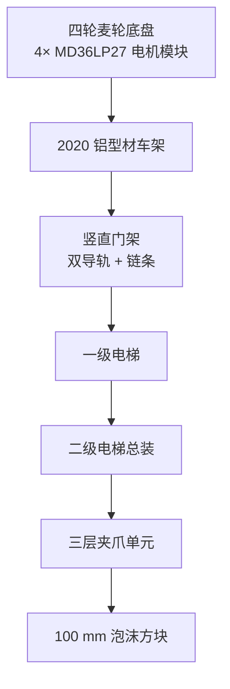

# RoboGame 2026 Mechanical System

本目录整理 RoboGame 2026 团队机器人项目的机械系统说明，面向机器人方向导师、机械工程师和开发者。内容以**原归档中的 2026-04～05 设计记录、2026-05～06 CAD 文件名/目录、五张已确认照片**为依据，区分“有证据的结构”“设计文档中的方案”“比赛规则约束”和“待核实参数”。

> 本目录不是制造图，也不能替代最终 CAD、BOM、装配记录或实车验证。机械图纸/CAD 文件目前**没有公开**：公开权限、第三方模型来源和仓库体积都尚未确认，详见 [cad/README.md](cad/README.md) 与 [drawings/README.md](drawings/README.md)。机器人源码与视觉对位的说明在仓库根目录和 `docs/`。

*图：机器人整体。四轮麦克纳姆轮底盘、竖直门架、三层夹爪单元和底盘电控区可见（照片为已确认公开展示的 `media/robot-overview.jpg`）。*

## Project Context

本项目是团队作品，最终获得 RoboGame 2026 竞技组一等奖；奖项属于团队，不代表个人独立完成整机或全部机械。2026-10-03 预赛进行了三座建筑相关任务，具体完成情况缺少逐项比赛日志，不能据此推算全部任务完成情况或抓取成功率；2026-10-04 八进四阶段两场均未获胜；现场抓取动作次数没有日志证明全部成功，因此本文不使用“18 次全部成功”或成功率表述。本人确认 `media/` 中照片对应比赛使用的最新机械版本实车。

队友姓名不在公开文档中列出（隐私/署名授权未确认），下文用“底盘队友”“后期底盘队友”“两位机械队友”等角色表述。

## 1. Mechanical System Overview

从照片、CAD 文件名和 2026-05-05 的《执行机构计划书》可以确认的设计意图是：

- **移动底盘**：四轮麦克纳姆轮、四组电机模块、2020 铝型材框架；CAD 文件名含 `100mm麦轮_左/右`、`MD36LP27` 直流电机和左/右轮组。
- **升降门架**：双导轨 + 链条驱动的两级升降（`一级电梯`、`二级电梯总装`），CAD 文件名含 `MGN12C-1-R-500` 直线导轨、05B 单排链轮和链条零件。
- **末端夹爪**：三层独立夹爪单元，计划书要求单电机驱动的对称齿条/滑轨夹持，抓取范围 0–127 mm；CAD 中出现 ST3215 舵机、25T 舵盘、齿轮/齿链、铝连接件、3D 打印连接件和迷你电动推杆。
- **结构框架**：2020 工业铝型材 + 20B 角铝/角码，门架两侧增加加强板，强调可拆装和标准件采购。

这些是**结构意图和文件名证据**。没有打开 SolidWorks 装配体，也没有对实车做尺寸、质量、刚度或寿命测量，因此不能把下列数字直接当作最终制造参数。

## 2. System Architecture

- 底盘承担移动、电池/电控和门架的反力。
- 门架承担升降行程和三层夹爪的倾覆力矩。
- 夹爪层间距、每层独立动作和升降高度由任务流程决定；机械结构与代码中的舵机 ID 3（升降）和 ID 0–2（夹爪）需要按实物再核对。

关联文档：

- [系统总览与尺寸证据](docs/system_overview.md)
- [麦轮底盘](docs/chassis_design.md)
- [升降机构](docs/lifting_mechanism.md)
- [三层夹爪](docs/gripper_design.md)
- [设计迭代](docs/design_iterations.md)
- [装配、调试与维护](docs/assembly_notes.md)

## 3. Design Constraints

下表中的数字主要来自内部设计检查清单/风险报告；它们首先是**规则和设计输入**，不是最终实测值。

| 约束 | 数值 | 证据状态 |
| --- | --- | --- |
| 建筑方块 | 约 100 × 100 × 100 mm 泡沫块 | 规则/设计文档；未见实物测量记录 |
| 材料槽深 | 约 50 mm | 规则/设计文档；决定夹爪不能依赖厚底托 |
| 初始尺寸上限 | 600 × 600 × 600 mm | 规则；历史线索与上限一致，但缺最终测量 |
| 展开尺寸上限 | 800 × 800 × 1000 mm | 规则；历史线索称约 650 × 600 × 1000 mm，二者不能混写 |
| 整机质量上限 | 25 kg | 规则；实车质量未记录 |
| 携带能力 | 最多 3 个方块、最多 1 个紫块 | 规则/设计文档；现场实际成功次数未验证 |
| 场地坡度 | 约 14° | 设计风险文档；未见坡度实测报告 |
| 放置稳定 | 脱手后保持约 3 s | 规则/设计文档；无成功率记录 |

## 4. Chassis Design

- **轮系**：CAD 文件名明确给出 `100mm麦轮_左.stp`、`100mm麦轮_右.stp`，即 100 mm 级麦克纳姆轮；照片可见四轮独立布置。
- **驱动**：底盘 CAD 中出现 `直流电机-MD36LP27（GMR）.stp` 与 `…（霍尔）.stp`，以及 `电机模块装配.SLDASM`。这说明最终底盘使用 MD36LP27 系列直流电机模块；具体减速比、编码器形式和四轮转向关系未在文件名中确认。
- **框架**：2020 工业铝型材（`工业铝型材2020.step`）、20B 系列角铝、M3/M5 滑块螺母；属于标准型材 + 角码的螺栓连接方案。
- **版本**：`底盘20250518` 是当前选定目录中的底盘版本名；`车6.3` 另存于原归档，是否为更晚/最终版本需确认。
- **未验证**：轴距、轮距、离地间隙、整车重心、悬架/减震、轮组刚度、坡道附着和电机实际电流均没有测量记录。不能把“四麦轮”写成已经完成运动学或动力学验证。

详见 [chassis_design.md](docs/chassis_design.md)。

## 5. Lifting Mechanism

设计文档给出“双导轨 + 链条驱动”，CAD 文件名进一步支持：

- `一级电梯.SLDASM`、`二级电梯总装.SLDASM`：两级升降结构；
- `MGN12C-1-R-500-ZF-C-M-E20.sldasm`：MGN12C 系列标准件型号；型号中的 `500` 只是候选长度标识，尚未取得产品样本、采购记录或实测数据，不能据此确认实际导轨长度；
- `单排链轮05B-14.DXF`、`单排链轮05B-18.DWG`、`链轮改1/2.SLDPRT`、`链条.SLDPRT`、`链条压紧支架…`：05B 单排链轮/链条与张紧件；
- `二级电梯下方备用限位块.SLDPRT`：至少存在二级电梯下方限位块零件；是否有完整限位开关方案待确认。

计划书写明初始高度 550 mm、最大高度 910 mm（均不含底盘），按文字计算为约 360 mm 行程；历史线索称约 400 mm；`MGN12C-500` 的 `500` 只是型号标识，不是已确认的导轨实际长度，也不等于有效运动行程。**型号标识、实际导轨长度、有效行程三者不能混用；最终值必须依据产品样本、采购记录、装配体尺寸或实测，当前标记为冲突/待核实。**

详见 [lifting_mechanism.md](docs/lifting_mechanism.md)。

## 6. Gripper Design

- **布局**：照片可见上、中、下三层夹持单元；《执行机构计划书》写明“三层独立夹爪 + 竖直门架”，每层独立控制。
- **方案**：计划书给出单电机驱动的对称齿条夹爪、滑轨直线运动、抓取范围 0–127 mm、对称夹持、橡胶垫和前端导向口。
- **CAD 证据**：`ST3215 Servo.SLDASM/.stp`、`main-horn-25T-4holes`、`ha8-hp8-hx8-series-3D.STEP`、`齿轮基座`、`夹爪齿链`、`夹爪齿轮3`、`夹爪连接打印件3/4`、`夹爪连接铝件1/2/3`、`迷你电动推杆(ZJWSN-MN2)[ZJWSN-MN2-S50].step`。文件名与“舵机 + 齿轮/齿条 + 打印件/铝件”的方向一致，但齿轮传动链、夹持力和运动副没有打开装配体验证。
- **两个版本**：`夹爪装配.SLDASM` 与 `无伸缩夹爪装配.SLDASM`、`无伸缩夹爪带滑块.SLDASM` 同时存在；哪个是最终版本、为什么出现“无伸缩”变体，当前没有设计变更记录，**【需要本人确认】**。
- **材料**：历史线索称曾考虑或使用 PA12；照片中可见白色打印件，CAD 文件名含“打印件”。但没有材料牌号、打印工艺、供应商或强度报告，不能把 PA12 写成已确认的最终材料。

详见 [gripper_design.md](docs/gripper_design.md)。

## 7. Mechanical Integration

- 底盘上平面安装门架、电池/电控和传感器支架；门架立柱连接一级/二级电梯；二级电梯滑台连接三层夹爪。
- 照片可见大量线束沿门架和底盘布置，但没有拖链型号、弯曲半径、固定点或线束长度记录。
- 三层夹爪同时外伸时，门架承受明显前翻力矩；设计文档建议控制导轨中心到方块重心的前伸，并优先采用双导轨、拉开导轨间距、降低末端质量。现有资料没有 FEA、倾覆试验或应变测量。
- 竞赛场地约 14° 坡道、启停冲击和放置碰撞会放大末端力矩；这是设计文档明确列出的风险，不是已测得的故障结论。

详见 [assembly_notes.md](docs/assembly_notes.md)。

## 8. Design Iterations

从文件日期和方案文本可以恢复出一条**有证据的时间线**，但缺少正式变更记录、评审结论和实车日志：

| 时间 | 资料 | 可确认内容 |
| --- | --- | --- |
| 2026-04-05 | `robogame机械方案.pdf` | 参考 RoboCon 类直线升降 + 平行夹爪，面向 100 mm 方块、50 mm 槽深 |
| 2026-04-06 | `关于直线升降机构的技术探索.pdf` | 分析“主升降 + 三层固定间距夹具 + 每层独立动作”的路线 |
| 2026-04-11 | 夹爪风险报告/设计总结 | 曾建议“气动夹爪 + 一级升降 + 同步带横移 + 主/转运分工” |
| 2026-04-12 | 夹爪设计检查清单 | 固化 100 mm 方块、50 mm 槽、600/800/1000 mm、25 kg、3 块、14°、3 s 等约束 |
| 2026-05-05 | 执行机构计划书 | 收敛为“三层独立夹爪 + 双导轨链条升降”，给出 0–127 mm、550→910 mm |
| 2026-05-13 | RoboGame 机械计划书 | 本人主要撰写机械部分；机械方案评审第 4 名（非最终比赛排名）；计划中出现 M3508 P19、STS3215 |
| 2026-05-30（目录名） | `电梯5.30` | 较晚的升降 CAD 版本目录名 |
| 2026-06-01 | 底盘优化讨论 | 门架偏高、夹爪单侧外伸、中部连接、门架根部、轮组位置、防撞结构等风险；建议是否落地未逐项确认 |
| 2026-06-17 | 转专业面试材料 | 记录“整车结构模型由本人独立完成建模设计”；属早期整车方案，不等于最终实车 |
| 2026-07-10 | 电控安装板 | 约 360×180 mm 超出打印机幅面；讨论拆分/缩小；最终方案未确认 |
| 2026-08-19 | 加工准备 | 联系学院加工资源，讨论图纸/材料/DXF 激光切割；无最终加工记录 |
| 2026-08 第二次评审前 | 升降实测 | 阻力大于预期；团队将 M3508 改为 45 kg 级舵机（非本人）；无阻力数据 |
| 2026-09-04 | 机械/底盘排查 | 约下午 2 点被叫去；约 9–10 天；随后转向算法 |
| 目录名 6.3（归档修改 2026-08-19） | `车6.3` | 另一个底盘/整车版本；版本关系待确认 |
| 2026-10-01 | `机械图纸/robogame决赛` | 当前选定的决赛 CAD 副本（含重复目录与锁文件） |

**已确认的变化方向**：4 月的“气动/一级升降/同步带横移”建议，与 5 月计划书及最终 CAD 的“电动三层夹爪/二级链条升降”不一致；最终底盘由另一位机械队友主导，和本人早期底盘方案差异较大；2026-08 升降驱动由团队从 M3508 改为 45 kg 级舵机，**不是本人工作**；最终装配主要由两位机械队友完成。**变化原因、评审结论和最终冻结版本没有完整记录，不能自行补写。**

详见 [design_iterations.md](docs/design_iterations.md)。

## 9. CAD Files and Publication Status

原归档 `机械图纸/robogame决赛` 约 342 个文件、190.6 MB，含 24 个装配体、238 个零件、14 个 `.STEP`、10 个 `.stp`、2 个 `.DWG`、2 个 `.DXF`，以及 `.p2m/.p2s`、`.hdr`、渲染贴图和 AutoCAD 锁文件。

- **本仓库没有复制这些 CAD**。原因：CAD/图纸的公开权限未确认；包含第三方标准件/参考模型；体积和格式不适合直接提交；Git LFS 尚未决策。
- 已发现 **158 组重复哈希、184 个重复副本**（含 `车`/`车 (1)` 两套完整目录、`~$` 临时文件、`.dwl/.dwl2` 锁文件）；发布前必须清理。
- 另有原归档 `RG/三审前/6-5工程.STEP` 约 147 MB 的全装配导出，以及多个 `电梯*.zip`、第三方参考模型；均未列入公开范围。
- 没有 SolidWorks/STEP 装配查看器可用，**未验证装配配合、干涉、质量和可制造性**；只核对了文件存在、扩展名、大小、部分 STEP/DWG 文件头和哈希重复。

详见 [cad/README.md](cad/README.md)。

## 10. Engineering Lessons Learned

- **多层并行夹爪**减少了重复升降次数，但把质量、线束、控制复杂度和层间干涉集中到门架前端；设计文档反复强调“末端轻、前伸短、下层主工作位”，这是正确的工程方向。
- **二级链传动**能以较轻结构获得较大行程，但链条张紧、链轮对齐、二级绳/重力补偿和限位设计决定可靠性；当前没有张紧力、寿命或冲击测试记录。
- **泡沫块夹持**的关键不是夹紧力越大越好，而是入口导向、背板/侧夹、薄唇边、防滑垫和放块后撤路径的配合；这些在 4 月风险报告和 5 月计划书中都有体现。
- **方案收敛**经历过气动/电动、一级/二级、同步带/链条、M3508/MD36LP27 等不同取舍；没有变更记录时，不能把早期建议写成最终实现。
- **机械与视觉/控制耦合**：夹爪前伸和升降高度会放大视觉对位误差；机械设计应尽量缩短前伸、增加导向容错，而不是只靠软件补偿。

## 11. Limitations and 待确认

- 最终尺寸、质量、重心、升降行程、负载、夹持力、重复定位精度、坡道稳定性和比赛成功率均无测量记录。
- CAD 装配体未打开，不能确认最终配合、干涉、零件数量和 BOM。
- 三层夹爪是“独立电机/齿条”还是其他传动，需按最终 CAD 和实物确认；`无伸缩夹爪` 是否为最终方案未定。
- PA12、橡胶垫、链条规格、轴承/滑块型号和紧固件扭矩均缺少材料/装配记录。
- 个人贡献已按本人确认补入：三组夹爪的连杆/驱动/材料/三层布局由本人完成；升降早期设计由本人参与，后期 M3508→45 kg 级舵机的更换由其他成员完成；最终底盘与最终整车装配由队友主导。具体文件级作者和“早期 CAD → 最终 CAD”的逐项对应仍需确认。
- CAD、工程图和第三方参考模型的公开授权未确认；未公开。

## 12. Contributors and Attribution

本项目为团队作品，最终获 RoboGame 2026 竞技组一等奖；奖项属于团队，不代表个人独立完成整机或全部机械。公开文档不写队友姓名（隐私/署名授权未确认），用角色表述。

| 工作 | 本人参与（本人确认） | 边界 |
| --- | --- | --- |
| 三组夹爪 | 连杆结构、驱动方案、材料选择、三层空间布局 | 本人完成四项设计；最终 CAD 的后续改动/装配需逐项对应 |
| 升降机构 | 参与早期设计、SolidWorks 建模 | 本人判断最终结构与早期差异不大；后期驱动更换不是本人 |
| 早期底盘 | 完成过底盘 CAD 方案与调整 | 最终底盘由另一位机械队友主导，差异较大 |
| 早期整车 CAD | 独立完成早期整车方案建模 | 不等于最终实车全部机械/装配 |
| 机械计划书 | 主要负责撰写 | 机械方案评审第 4 名，不是最终比赛排名 |
| 最终整车装配 | 不是主要负责人 | 主要由两位机械队友完成 |
| 9 月机械/底盘故障处理 | 9 月 4 日起约 9–10 天参与 | 与算法/电控耦合，不能全部归因机械 |
| 后期算法/系统 | 双循迹、树莓派、视觉与整机联调 | 已不属于机械设计 |

“本人确认”指本人复盘/补充确认，不是独立文件证据。CAD 文件本身没有作者字段可供核验；不能仅凭文件存在推断独立 authorship。

## 13. Related Documents

- [机械 CAD 状态](cad/README.md)
- [工程图状态](drawings/README.md)
- [BOM 状态](bom/README.md)
- [图片来源](images/README.md)
- [仓库主 README](../README.md)
- [硬件说明](../docs/hardware.md)
- [开发复盘](../docs/development_notes.md)
- [事实核查](../docs/fact_check.md)

## 14. 公开授权确认（2026-10-24）

本节记录 2026-10-24 的授权确认，**不是独立书面授权**。当前 `mechanical/` 为本地整理稿，团队公开范围已由本人确认已获团队授权（无独立书面材料）；不得把本记录表述为独立法律审查或伪造确认文件。

| 文件 | 内容类型 | 个人/团队属性 | 授权记录 | 确认范围/备注 |
| --- | --- | --- | --- | --- |
| `mechanical/README.md` | 机械总览/贡献边界 | 个人叙述 + 团队项目信息 | 已确认（2026-10-24，本人陈述） | 团队对公开范围、队友角色描述的确认 |
| `docs/system_overview.md` | 尺寸/布局/结构/角色 | 团队项目信息 | 已确认（2026-10-24，本人陈述） | 团队/相关队友 |
| `docs/chassis_design.md` | 早期底盘 + 最终底盘对照 | 个人早期 CAD + 队友最终方案 | 已确认（2026-10-24，本人陈述） | 底盘相关队友 |
| `docs/lifting_mechanism.md` | 升降早期设计 + 驱动更换 | 个人早期设计 + 团队变更 | 已确认（2026-10-24，本人陈述） | 升降/驱动相关队友 |
| `docs/gripper_design.md` | 三组夹爪四项设计 + 两个版本 | 个人设计 + 最终 CAD/装配团队信息 | 已确认（2026-10-24，本人陈述） | 夹爪/最终 CAD 相关队友 |
| `docs/design_iterations.md` | 项目时间线/团队分工 | 团队内部过程信息 | 已确认（2026-10-24，本人陈述） | 全体相关队友 |
| `docs/assembly_notes.md` | 制造/装配/调试节点 | 团队过程信息 | 已确认（2026-10-24，本人陈述） | 装配/加工相关队友 |
| `cad/README.md` | CAD 清点/授权状态 | 团队 CAD 目录信息 | 已确认（2026-10-24，本人陈述）；无 CAD 文件 | 团队 CAD 权利确认 |
| `drawings/README.md` | 图纸清点/授权状态 | 团队图纸信息 | 已确认（2026-10-24，本人陈述）；无图纸文件 | 团队图纸权利确认 |
| `bom/README.md` | BOM 缺失说明 | 团队物料信息 | 已确认（2026-10-24，本人陈述）；无 BOM 文件 | 团队/采购确认 |
| `images/README.md` | 五张已确认图片的引用说明 | 图片权限已确认；说明文本属机械模块 | 图片展示已确认；说明文本已确认（2026-10-24，本人陈述） | 团队确认说明文本范围 |

**个人设计内容（本人确认，团队公开范围已由本人确认已获团队授权；无独立书面材料）**：三组夹爪的连杆结构、驱动方案、材料选择、三层空间布局；升降机构早期设计；早期底盘/早期整车 CAD 方案；机械计划书主要撰写。

**团队共同设计/后期工作（不属于本人独立完成）**：最终底盘方案（由另一位机械队友主导）、最终整车装配（主要由两位机械队友完成）、M3508→45 kg 级舵机驱动更换（由其他成员完成）、团队比赛结果与现场分工。

**不存在未获授权的照片/模型/图纸进入本仓库**：`mechanical/` 只有 Markdown 说明；没有 CAD/STEP/DWG/DXF、第三方模型、BOM 或新增图片。仅引用 `media/` 中已确认展示的五张图片；图片展示授权不自动等于 MIT 再授权。

**当前结论：已确认（2026-10-24，本人陈述已获团队授权；无独立书面材料）。** 本轮可按该确认提交；如团队后续提出异议，应回退相关公开内容。不得把本记录表述为独立书面授权或伪造同意文件。
